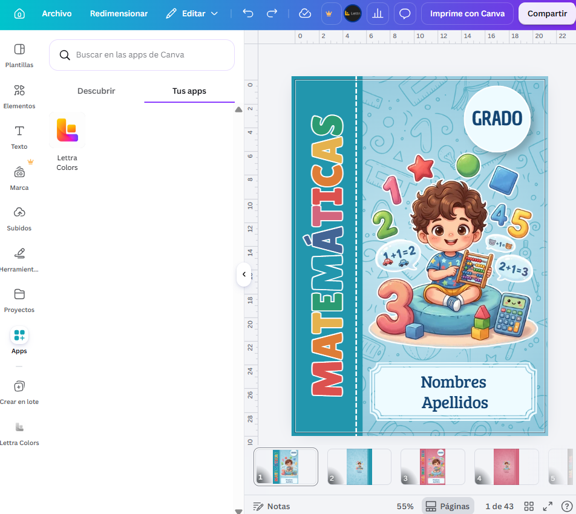
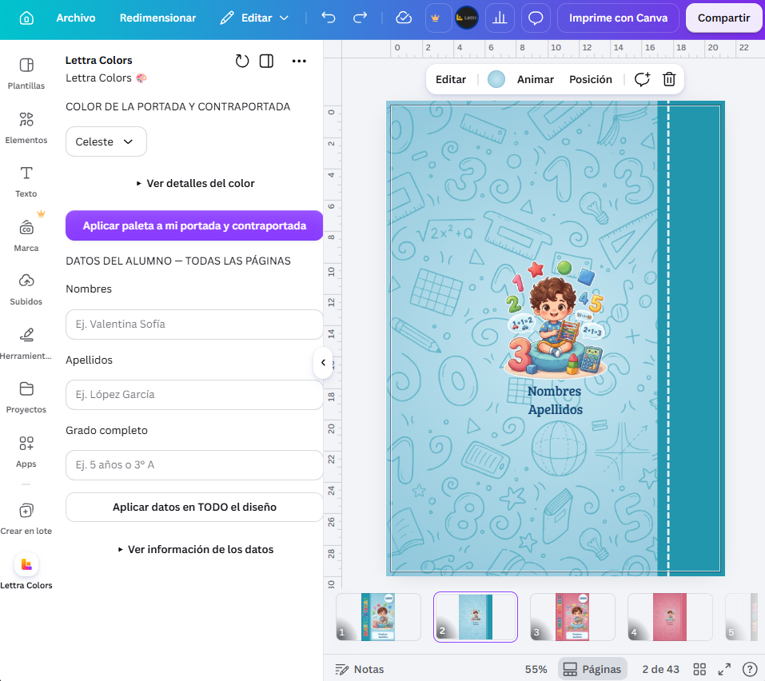
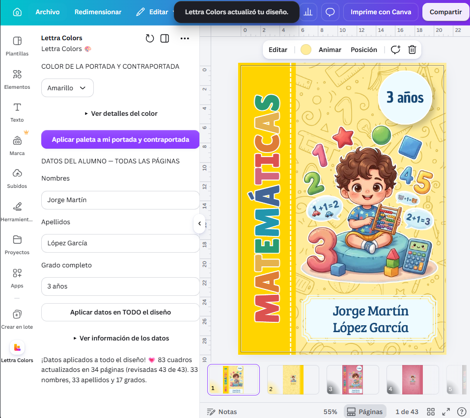
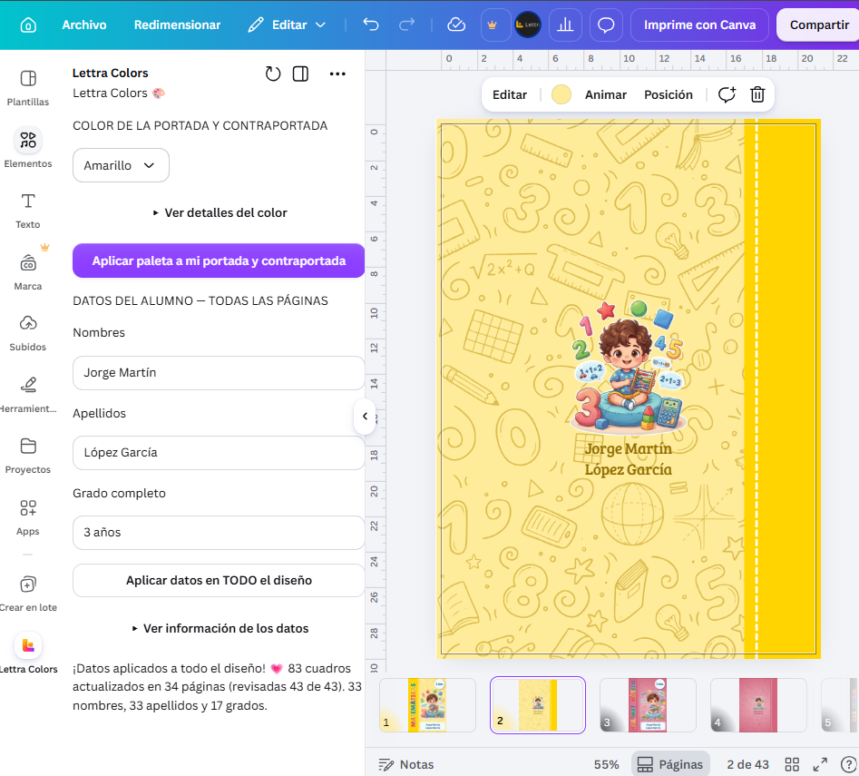
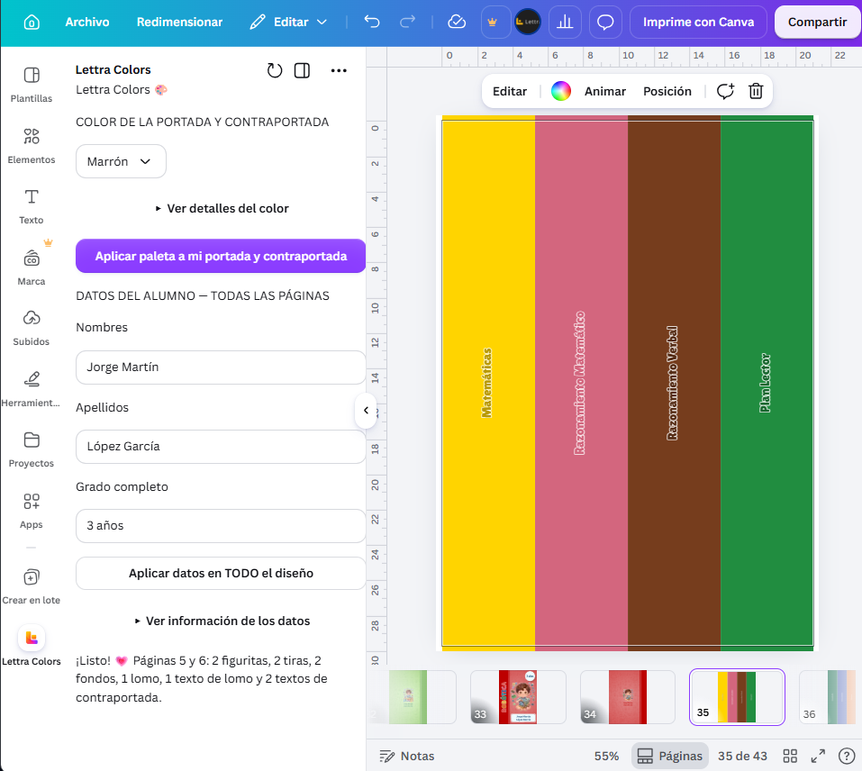

# Lettra Colors 1.0

Herramienta para Canva que automatiza la personalización de portadas, contraportadas y lomos de cuadernos escolares.

## Estado del proyecto

Versión 1.0 funcional utilizada en un entorno de desarrollo de Canva. Aún no está publicada en su catálogo de aplicaciones.

## Contexto de uso

Desarrollé Lettra Colors para facilitar la personalización de las plantillas escolares de mi emprendimiento, Lettra.

La herramienta trabaja con la estructura y los elementos de los diseños utilizados en el proyecto. Su compatibilidad con otras plantillas requiere revisión y adaptación.

## Problema que resuelve

La personalización manual de cuadernos escolares requiere repetir cambios de colores, nombres, apellidos y grado en distintas páginas.

Lettra Colors reúne estas tareas en una interfaz dentro de Canva para facilitar la preparación de los diseños.

## Cómo funciona

La herramienta cuenta con dos funciones principales.

### Personalización de colores

- Permite elegir entre 21 paletas de colores.
- Cambia el fondo de la portada y contraportada.
- Actualiza las franjas laterales y los colores de las ilustraciones SVG compatibles.
- Modifica el lomo correspondiente, conservando el borde blanco de sus letras.

### Personalización de datos

- Permite ingresar nombres, apellidos y grado del estudiante.
- Busca cuadros de texto con las etiquetas originales de la plantilla.
- Reemplaza las coincidencias en las páginas del diseño.
- Permite dejar vacíos los campos que no se quieren modificar.

El reemplazo busca las etiquetas NOMBRES, APELLIDOS y GRADO, además del ejemplo de grado 3° A. Si estos textos ya fueron reemplazados, la herramienta no vuelve a encontrarlos mediante esas etiquetas.

## Tecnologías utilizadas

- **TypeScript:** lógica de personalización de los diseños.
- **React:** interfaz de la herramienta.
- **Canva Apps SDK:** integración con el editor de Canva.
- **SVG:** procesamiento y recoloración de ilustraciones.
- **Node.js y npm:** entorno de desarrollo y gestión de dependencias.
- **Visual Studio Code:** editor utilizado durante el desarrollo.

## Validación técnica

Durante el desarrollo de la versión 1.0 se realizaron las siguientes comprobaciones:

- Revisión de tipos de TypeScript sin errores.
- Compilación con Canva CLI.
- Pruebas manuales de personalización dentro de Canva.

**Pendiente:** revisión de reglas de ESLint y desarrollo de pruebas automatizadas propias.

## Instalación y ejecución local

### Requisitos

- Node.js 24 y npm 11.
- Git.
- Una cuenta de Canva con acceso al Developer Portal.
- Una aplicación creada en el Developer Portal para vincular este proyecto.

### 1. Descargar el proyecto

```bash
git clone https://github.com/blas-meylin/lettra-colors-canva-app.git
cd lettra-colors-canva-app
```

Si el repositorio es privado, se necesita autorización para descargarlo.

### 2. Instalar las dependencias

```bash
npm ci
```

### 3. Vincular el proyecto con Canva

Iniciar sesión:

```bash
npx @canva/cli login
```

Vincular la carpeta con una aplicación a la que se tenga acceso:

```bash
npx @canva/cli apps link
```

Seguir las indicaciones de la terminal. La vinculación configura el archivo `.env` local.

El archivo `.env.template` contiene los nombres de las variables de configuración. No es necesario completar todas las variables para todos los proyectos.

El archivo `.env` debe permanecer fuera del repositorio.

### 4. Iniciar el entorno de desarrollo

```bash
npm start
```

Abrir el enlace de vista previa de Canva que aparece en la terminal. Mantener la terminal abierta mientras se utiliza la herramienta.

Para detener el servidor, presionar `Ctrl + C`.

### 5. Probar las funciones

Utilizar una copia de un diseño compatible con la estructura de las plantillas de Lettra. Probar los cambios de colores y el reemplazo de textos sobre esa copia.

Descargar el código no proporciona acceso a las plantillas comerciales de Lettra ni publica la aplicación en Canva.

## Comandos de revisión

Revisar los tipos de TypeScript:

```bash
npm run lint:types
```

Comprobar las reglas de código:

```bash
npm run lint
```

Compilar el proyecto:

```bash
npm run build
```

Estos comandos no sustituyen las pruebas de funcionamiento dentro de Canva.

## Capturas de pantalla

### 1. Aplicación integrada en Canva



### 2. Interfaz de Lettra Colors



### 3. Portada personalizada



### 4. Contraportada personalizada



### 5. Lomos actualizados



## Recursos visuales

Las ilustraciones y los fondos utilizados en las capturas se generaron con herramientas de inteligencia artificial. Los fondos se convirtieron posteriormente a SVG para permitir su recoloración.

Los nombres y demás datos mostrados son ficticios y se utilizan únicamente para demostrar el funcionamiento de la herramienta.

## Créditos y licencia

Proyecto desarrollado para Lettra a partir del starter kit de Canva Apps SDK.

La licencia de los componentes de Canva se conserva en el archivo [LICENSE.md](LICENSE.md).